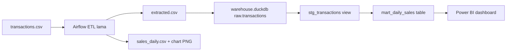

# Workplan Tugas Lanjutan: dbt + Dashboard BI

**Mahasiswa:** Muhammad Aziiz Pranaja  
**NIM:** 25/572885/PPA/07200  
**Mata kuliah:** Data Warehouse dan Business Intelligence  
**Project ini:** `D:\Kuliah\DWIB\25_572885_PPA_07200_MuhammadAziizPranaja_dbtBI`  
**Tugas Airflow lama:** `D:\Kuliah\DWIB\airflow-etl-sales-fmcg` (repo terpisah, tidak diubah)

Tugas baru tidak mengganti ETL lama. Repo ini adalah project submission dbt + BI. Data raw adalah snapshot hasil extract Airflow.

---

## Status scaffold

| Fase | Status |
| --- | --- |
| 0 Struktur repo | selesai |
| 1 Handoff CSV → DuckDB | selesai (`raw.transactions` = 1.800 baris) |
| 2 Scaffold dbt | selesai (`dbt debug` lolos) |
| 3 Staging | selesai (`stg_transactions` view) |
| 4 Mart | selesai (`mart_daily_sales` incremental, bonus +3%) |
| 5 Tests dbt | selesai (`dbt run` + 9 tests PASS) |
| 6 Dashboard Power BI | belum (folder `dashboard/` kosong) |
| 7 Dokumentasi PDF | selesai (`docs/dokumentasi.docx` + `.pdf`, 4 halaman) |
| 8 GitHub + bukti screenshot | belum; `git init` lokal sudah ada, remote menyusul |

---

## 1. Keputusan utama agar tetap selaras

Pilih **Opsi A** (lanjutan tugas Airflow), bukan dataset baru.

Sumber “raw” untuk dbt adalah **transaksi grain** (`extracted.csv`), bukan agregasi `sales_daily.csv`. Kalau hanya agregasi yang dipakai, staging → mart jadi kosong dan angka kualitas data sebelum/sesudah tidak bisa dihitung.

### 1.1 Handoff tugas lama → project ini

| Lapisan | Sumber di repo Airflow | Peran di project ini |
| --- | --- | --- |
| Ingest Airflow | `data/raw/transactions.csv` | tidak diubah di repo lama |
| Extract Airflow | `data/staging/extracted.csv` | disalin ke `data/raw/transactions.csv` |
| Validasi Airflow | log null/duplikat | dilanjutkan di dbt tests |
| Transform Airflow | `sales_daily.csv` | acuan pertanyaan bisnis, bukan sumber dbt |
| dbt staging | — | `stg_transactions` (view) |
| dbt mart | — | `mart_daily_sales` (table) |
| Dashboard | chart matplotlib | Power BI di `dashboard/` |

**Pertanyaan bisnis yang dipertahankan:** berapa total penjualan, kuantitas, dan jumlah order per hari?

### 1.2 Arsitektur



---

## 2. Ringkasan tugas Airflow (tidak diubah)

`extract_data` → `validate_data` → `transform_data` → `load_data`

| Item | Nilai |
| --- | --- |
| DAG | `etl_sederhana_25_572885_PPA_07200` |
| Dataset | penjualan harian FMCG, 1.800 baris |
| Kolom | `order_id`, `order_date`, `product`, `category`, `quantity`, `sales`, `region` |
| Output wajib | `data/output/sales_daily.csv` |
| Output bonus | `data/output/sales_by_category.csv` |

---

## 3. Temuan kualitas di raw

| Masalah | Jumlah | Perlakuan di dbt |
| --- | --- | --- |
| `order_date` null | 83 | dibuang di staging |
| `quantity` null | 180 | diisi 0 di staging |
| `sales` null | 353 | dibuang di staging |
| `quantity` negatif | 70 | dibuang di staging |
| `sales` negatif | 62 | dibuang di staging + custom test |
| Region `USA` vs `United States` | ada | dinormalisasi di staging |
| Duplikat baris / `order_id` | 0 | generic `unique` tetap dipasang |

---

## 4. Struktur project ini

```text
25_572885_PPA_07200_MuhammadAziizPranaja_dbtBI/
|-- dbt_project/
|   |-- models/staging/stg_transactions.sql
|   |-- models/marts/mart_daily_sales.sql
|   |-- tests/assert_no_negative_sales.sql
|   |-- dbt_project.yml
|   `-- profiles.yml
|-- data/raw/transactions.csv
|-- data/warehouse.duckdb
|-- dashboard/
|-- docs/
|-- scripts/load_raw_to_duckdb.py
|-- WORKPLAN.md
`-- README.md
```

Repo GitHub nanti memakai nama yang sama atau `[NIM]_[Nama]_dbtBI`.

---

## 5. Sisa pengerjaan

### Fase 6 — Dashboard BI

Power BI Desktop, satu layar:

| Elemen | Isi |
| --- | --- |
| KPI card | Total penjualan |
| Chart 1 (line) | Penjualan harian |
| Chart 2 (bar) | Penjualan per kategori |
| Slicer | Kategori / region / rentang tanggal |

Sumber: `mart_daily_sales` (bukan CSV output Airflow). Simpan `dashboard/fmcg_sales.pbix`.

Bonus (+4%): tab kedua atau drill-down.

### Fase 7 — Dokumentasi 3–5 halaman

| Bagian | Isi |
| --- | --- |
| A | Dataset FMCG; kaitan dengan tugas Airflow; pertanyaan bisnis |
| B | Staging view vs mart table; screenshot lineage |
| C | Tests; jumlah baris bermasalah sebelum/sesudah staging; screenshot `dbt test` |
| D | Screenshot dashboard dan alasan chart |
| E | Kendala & solusi |
| F | Insight + pengembangan lanjutan |

### Fase 8 — GitHub

Setelah repo GitHub dibuat:

```powershell
git init
git add .
git commit -m "Initial dbt + BI project scaffold"
git remote add origin <URL_REPO>
git push -u origin main
```

Jangan commit lagi setelah deadline Classroom.

---

## 6. Urutan yang tidak boleh dibalik

1. DuckDB terisi dari snapshot extract Airflow
2. Staging lolos `dbt run`
3. Mart lolos `dbt run`
4. Tests hijau
5. Dashboard dari mart
6. Dokumentasi terakhir

---

## 7. Mapping persyaratan PDF

| Requirement PDF | Artefak |
| --- | --- |
| Opsi A sumber Airflow | `data/raw/transactions.csv` → `raw.transactions` |
| Staging view | `stg_transactions.sql` |
| Mart table + `ref()` | `mart_daily_sales.sql` |
| Minimal 2 generic tests | `not_null`, `unique` di `schema.yml` |
| 1 custom singular test | `tests/assert_no_negative_sales.sql` |
| `dbt docs` + lineage | screenshot di `docs/` |
| KPI + 2 chart + 1 filter | `dashboard/fmcg_sales.pbix` |
| Dokumentasi 3–5 halaman | `docs/dokumentasi.pdf` |

---

## 8. Perintah rutin

```powershell
python scripts\load_raw_to_duckdb.py
cd dbt_project
$env:DBT_PROFILES_DIR = (Get-Location).Path
dbt run
dbt test
dbt docs generate
```
